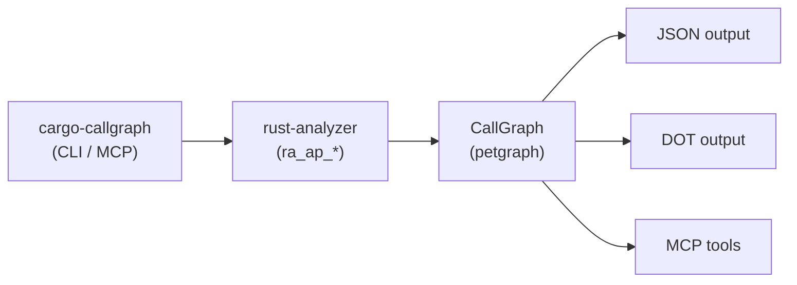

# cargo-callgraph

Generate static callgraphs for Rust workspaces using [rust-analyzer](https://rust-analyzer.github.io/) internals. Built on [petgraph](https://github.com/petgraph/petgraph) with JSON/DOT export, graph traversal queries, and an MCP server for AI assistants.

## Credits

This is a modified/updated download/fork of v. 0.1.0 of
[crates.io/crates/cargo-callgraph](https://crates.io/crates/cargo-callgraph),
originally by [Sienna Meridian Satterwhite](https://github.com/siennathesane/).

## Features

- **Workspace-scoped** — traces calls across all local crates, stopping at `std`/`core`/`libc` boundaries
- **Trait resolution** — maps trait method calls to their concrete implementations via `goto_implementation`
- **Graph export** — JSON (for programmatic use) and Graphviz DOT (for visualisation)
- **Traversal queries** — search, incoming/outgoing traversal, and pathfinding between nodes
- **MCP server** — exposes the callgraph as tools to AI assistants (Kimi, Claude, etc.)
- **Persistent cache** — disk-caches generated graphs keyed by manifest hash + mtime

## Installation

```bash
cargo install --path .
```

Or from crates.io:

```bash
cargo install cargo-callgraph
```

The binary is registered as a Cargo subcommand, so it can be invoked as:

```bash
cargo callgraph
```

## CLI Usage

### Generate a callgraph

```bash
# Auto-detect Cargo.toml in current directory or ancestors
cargo callgraph --json callgraph.json --dot callgraph.dot

# Explicit manifest path
cargo callgraph --manifest-path ./my-app/Cargo.toml --dot callgraph.dot
```

### Traverse a pre-generated graph

```bash
# Show what `main` calls (outgoing), depth 3
cargo callgraph traverse --graph callgraph.json -i main -n 3 -o

# Show what calls `validate` (incoming)
cargo callgraph traverse --graph callgraph.json -i validate -n 3
```

### Example output

```
main (L8)
├── handlers::init_server
│   ├── handlers::load_config
│   └── validate (L34)
└── handlers::handle_request
    ├── handlers::parse_request
    ├── validate (L47)
    ├── process (L54)
    └── handlers::send_response
```

## MCP Server

Start the MCP server over stdio:

```bash
cargo callgraph mcp
```

### Available tools

| Tool | Description |
|------|-------------|
| `generate_callgraph` | Load or generate a callgraph for a workspace |
| `traverse_outgoing` | Show callees from a node (with edge annotations) |
| `traverse_incoming` | Show callers to a node |
| `find_call_paths` | Find all paths between two nodes |
| `search_nodes` | Search by name or qualified path |
| `get_node_details` | Full metadata for a node (location, crate, module, etc.) |
| `list_crates` | List crates in the workspace |
| `summarize_graph` | Summary: entry points, hotspots, leaf functions, max depth |
| `explore_workspace` | TOC grouped by crate::module |
| `find_dead_code` | Workspace functions with no callers |
| `find_cycles` | Recursive call loops in the graph |
| `find_bottlenecks` | Functions with high in-degree |

### Kimi Code configuration

Add to `~/.kimi-code/mcp.json`:

```json
{
  "mcpServers": {
    "cargo-callgraph": {
      "command": "cargo-callgraph",
      "args": ["mcp"]
    }
  }
}
```

### Cache behaviour

The MCP server uses a three-tier lookup:

1. **In-memory** — graphs cached for the lifetime of the MCP session
2. **Disk cache** — stored in `~/.cache/cargo-callgraph/<hash>.json`, validated by `Cargo.toml` mtime
3. **Regenerate** — triggered on first use, manifest change, or when `reload: true` is passed

## Architecture



## Example: tokio-app

The `examples/tokio-app` crate demonstrates async call tracing with custom traits:

```bash
cd examples/tokio-app
cargo callgraph --json callgraph.json --dot callgraph.dot
```

This produces a 10-node, 9-edge graph showing calls through `Validate` and `Process` trait implementations.

## Edge kinds

| Kind | Meaning |
|------|---------|
| `DirectCall` | A direct function call |
| `TraitDefCall` | Call to a trait method definition |
| `StaticTraitCall` | Call resolved to a specific trait impl |
| `DynamicDispatch` | Dynamic dispatch (not yet traced) |


